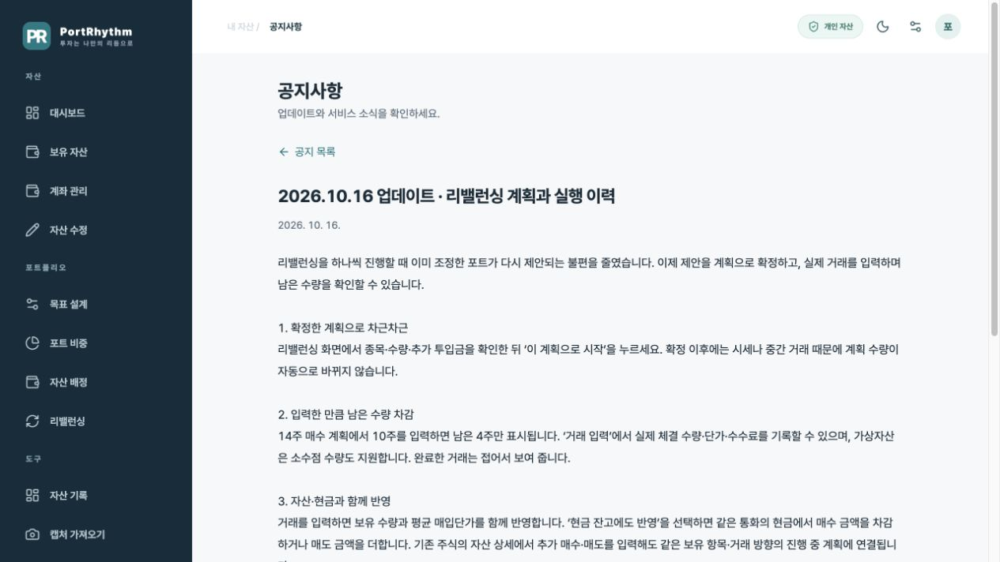

# PortRhythm 운영 관리

## 접근

로그인 후 사이드바의 **운영 관리**, 모바일 **전체 → 관리자 전용 · 운영 관리**를 선택합니다. 직접 주소는 `https://pf.promleeblog.com/admin`입니다. 일반 계정에는 메뉴가 없으며, 서버 페이지와 API에서도 권한을 검사합니다.

## 제공 기능

- 사용자 수, 최근 30일 로그인 사용자 수, 현재 게시 중 공지 수
- PortRhythm 등록 사용자 검색·페이지 이동: 닉네임, 로그인 제공자, 서비스 등록 시각, 최근 로그인, 관리자 여부
- 공지 작성·수정: 제목, 일반 텍스트 내용, 중요 여부, 게시 상태, 시작·종료 시각
- 최근 30개 운영 변경 이력: 관리자, 시각, 작업, 공지 제목·상태

사용자 조회는 계정 운영 정보만 제공합니다. 개인 보유 종목·수량·자산 금액은 표시하지 않습니다. 계정 차단·삭제와 관리자 권한 변경은 이 화면에서 제공하지 않습니다.

## 공지 운영

1. **공지 작성**을 눌러 제목과 내용을 입력합니다. 기본 상태는 **초안**입니다.
2. **게시**를 선택하면 시작 시각부터 사용자 화면 상단 공지 목록에 표시됩니다. 시작 시각을 비우면 저장 즉시 게시합니다.
3. 종료 시각을 비우면 기한 없이 게시합니다. **게시 종료**로 변경하면 사용자에게 숨기며 관리자 목록과 이력을 보존합니다.
4. 사용자 화면 상단에는 최신 공지 하나만 표시합니다. 사용자가 닫으면 같은 브라우저에서 해당 공지는 다시 표시하지 않고, 새 공지가 게시되면 다시 표시합니다. 전체 메뉴 → 공지사항에서 게시 공지를 최신순으로 확인하며, 제목을 누르면 전용 화면에서 본문을 봅니다. 중요 공지는 중요 표시로 구별합니다.

날짜 입력은 관리자의 기기 시간대를 따르며 DB에는 UTC로 저장합니다. 기간 시작은 포함하고 종료 시각은 포함하지 않습니다. 공지는 로그인한 사용자가 앱을 새로 열거나 새로고침할 때 받아옵니다. HTML을 실행하지 않는 일반 텍스트이며 최대 제목 120자·내용 10,000자입니다.

같은 공지를 여러 곳에서 수정하면 먼저 저장한 결과를 보존하고, 뒤의 저장은 충돌 메시지를 표시합니다. 목록을 갱신한 후 다시 수정하세요. 공지 작성 중 탭 이동·앱 복귀·새로고침에는 미저장 변경 확인이 적용됩니다. 모바일 브라우저의 강제 종료 시 초안 복구는 제공하지 않습니다.

## 사용자 집계 기준

`portfolio.members`에 등록된 사용자만 조회합니다. 공유 `public.User`의 다른 서비스 사용자 전체를 조회하지 않습니다. 기존 PortRhythm 포트폴리오 사용자는 운영 기능 도입 시 등록됐으며, 새 사용자는 PortRhythm 로그인 성공 시 등록됩니다. 최근 로그인 집계는 도입 이후의 성공한 로그인부터 시작하며, 이미 유지 중인 세션이나 단순 페이지 방문은 새 로그인으로 세지 않습니다.

사용자 목록은 페이지당 30명, 공지 관리 목록은 최근 수정 100개, 사용자 공지는 현재 게시 50개, 운영 기록은 최근 30개입니다. 로컬 QA 사용자도 등록 사용자 목록에 표시되며 로그인 방식으로 구별합니다.

## 권한과 데이터 보호

권한은 `portfolio.members.is_admin`에 저장합니다. JWT의 사용자 편집 메타데이터나 클라이언트에서 전달한 역할을 사용하지 않습니다. 서버는 매 요청마다 DB 권한을 확인하고, 공지 저장 트랜잭션에서는 다시 확인해 권한 해제와 저장의 경합을 방지합니다. 공지 변경과 운영 기록은 하나의 트랜잭션으로 저장합니다.

`members`, `announcements`, `admin_events`는 비공개 `portfolio` 스키마에 있고 RLS가 켜져 있습니다. `anon`, `authenticated`, `PUBLIC`의 직접 접근 권한은 없습니다. 서버의 기존 DB 연결로만 접근합니다. Supabase의 `RLS enabled no policy` 정보 안내는 이 서버 전용·기본 거부 구조에서 의도한 상태입니다.

새 관리자를 지정할 때는 운영자가 실제 사용자 ID를 확인한 뒤 신뢰하는 DB 관리 경로에서 변경해야 합니다. 공유 사용자 테이블의 권한은 변경하지 않습니다. 기존 로컬 QA 로그인은 개발 모드에서만 운영 화면 테스트에 사용할 수 있고, 프로덕션에서는 관리자 권한을 부여하지 않습니다.

## 검증 (2026-10-14)

- 자동 테스트: 비로그인·일반 계정 차단, 다른 출처 요청 차단, 잘못된 입력, 권한 해제 경합, 버전 충돌, 운영 기록 원자성, 프로덕션 QA 우회 차단
- 실제 DB: 새 테이블 RLS·직접 접근 권한 확인, 예약·만료·초안·게시 종료 공지 제외 확인
- 로컬 QA 브라우저: 초안 작성 → 저장 → 게시 종료 수정 → 새로고침 → 운영 기록, 사용자 조회
- 검증용 공지는 사용자에게 게시하지 않았으며 테스트 종료 후 정리했습니다.

## 공지 푸시 알림

게시 공지에서 **푸시 알림도 보내기**를 선택해 저장하면 알림을 켠 기기에 발송합니다. 예약 공지는 게시 시각 이후 처리합니다. 공지별 요청은 한 번만 등록하며, 목록에서 발송 성공·실패 건수를 확인합니다. 실제 수신·열람 확인과는 다릅니다. 자세한 설정·운영 방식은 [푸시 알림 안내](PUSH_NOTIFICATIONS.md)를 참고하세요.
