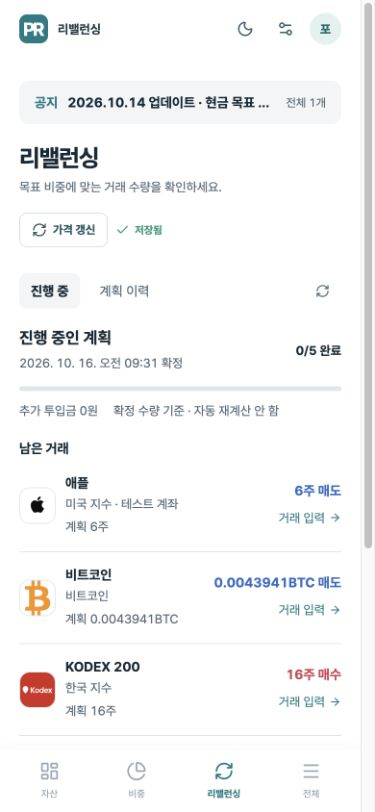

# 리밸런싱 계획과 실행 이력

## 사용 흐름

1. 리밸런싱의 **새 계획**에서 종목·수량·추가 투입금을 검토합니다.
2. **이 계획으로 시작**을 누르면 서버가 최신 보유 정보로 계산하고 종목·수량·목표 비중·가격·환율을 확정합니다.
3. **진행 중** 화면의 **거래 입력**에서 실제 체결 수량·단가·수수료를 입력합니다. 실제 주문은 증권사·거래소에서 직접 진행합니다.
4. 14주 매수 계획 중 10주를 입력하면 **남은 4주**만 표시합니다. 같은 계획의 수량은 시세 변동이나 중간 거래 때문에 다시 늘어나지 않습니다.
5. 모든 항목이 반영되면 완료 처리하고 **계획 이력**에서 최종 결과를 보여 줍니다. 새 계산은 **새 계획 계산**을 눌러 시작합니다.

계획 확정 자체는 보유 수량·현금 잔고를 변경하지 않습니다. 추가 투입금도 자동 입금 처리하지 않습니다. 거래 입력은 이미 증권사·거래소에서 체결한 내역을 앱 잔고에 기록하는 기능입니다.



## 거래 입력

- 주식: 기존 보유 종목은 확정 계좌에 반영합니다. 신규 매수 종목은 내 계좌를 선택해 최초 보유 항목을 만들 수 있습니다.
- 비트코인 등 가상자산: 소수점 8자리까지 부분 실행을 기록합니다.
- 추가 매수는 기존 원가와 수수료를 포함해 평균 매입단가를 다시 계산합니다. 부분 매도는 남은 평단을 유지합니다.
- **현금 잔고에도 반영**을 선택하면 같은 통화의 현금 자산과 함께 저장합니다. 미국 주식은 달러, 국내 주식·원화 가상자산은 원화입니다. 선택하지 않으면 수량·평단·진행률만 변경됩니다.
- 계획의 종목명을 누르면 기존 자산 상세를 열어 확인할 수 있습니다. 실행 내역의 날짜는 거래를 앱에 입력한 시각입니다.
- 기존 **자산 상세 → 추가 매수·매도**로 입력해도 진행 중 계획의 동일 보유 항목·거래 방향과 맞으면 진행률에 자동 반영합니다. 같은 코드라도 다른 계좌를 임의로 연결하지 않습니다.
- 기존 보유 수량을 통째로 수정하거나 OCR로 다시 등록하는 작업은 거래 내역으로 추정하지 않습니다. 계획을 점검하고 필요하면 중단 후 새 계획을 만드세요.
- 계획을 초과한 실제 거래는 일반 자산 수정에서 기록할 수 있습니다. 진행 중인 동일 항목에 연결되면 실제 수량을 이력에 남기고 남은 수량은 0으로 처리합니다.

## 이력 관리

- 계정당 진행 중인 계획은 하나입니다. 완료·중단한 계획은 최신순 목록으로 보관하며 이전 이력을 더 불러올 수 있습니다.
- 계획별 확정 시각, 추가 투입금, 진행률, 남은 거래, 완료 거래, 실제 실행 내역을 확인할 수 있습니다.
- 완료·중단 시 확정 당시 목표·예상 비중과 종료 시 실제 비중을 비교합니다. 이후 시세가 바뀌어도 저장된 종료 결과는 바뀌지 않습니다.
- **계획 중단**은 남은 제안만 종료합니다. 이미 반영한 거래·자산은 되돌리지 않습니다.
- 진행 중인 계획이 없고 종료 이력이 있으면 마지막 결과를 먼저 보여 줍니다. 새 제안은 사용자가 새 계획을 선택할 때 계산합니다.
- 완료 뒤 **새 계획 계산**을 누르면 이전 추가 투입금과 직접 선택을 초기화해 이전 투자금을 다시 더하는 일을 막습니다. 방법·허용 오차 설정은 유지합니다.
- 진행 중 목표나 배정·계좌를 바꾸면 실행을 막거나 최종 결과에 구성 변경을 표시합니다. 계획과 실제 잔고가 달라졌다면 중단 후 새 계획으로 시작하는 편이 명확합니다.

## 저장·보안

`portfolio.rebalance_runs`는 확정 계획·종료 결과를, `portfolio.rebalance_fills`는 실제 실행을 저장합니다. 기존 자산과 분리해 원래 수량을 다시 덮어쓰지 않습니다.

두 테이블 모두 RLS를 활성화하고 공개·anon·authenticated 직접 접근 권한을 제거했습니다. 서버 API는 세션의 사용자 ID로만 조회·저장하며 요청 본문의 사용자 ID를 신뢰하지 않습니다. POST는 동일 출처만 허용합니다.

거래 입력은 사용자 포트폴리오 잠금 아래에서 자산·현금·실행 내역·진행률·기록을 한 트랜잭션으로 저장합니다. 남은 수량 초과, 오래된 계획 버전·보유 수량, 외부 계좌·현금, 잔고 부족은 반영하지 않습니다. 재시도 요청 ID와 원문 해시로 동일 거래의 중복 반영을 막습니다.

## 검증

```sh
cd apps/web
node --test tests/*.test.mjs
pnpm exec tsc --noEmit
pnpm build

# .env.local의 LOCAL_ADMIN_USER_ID가 GUEST인 폐기 가능한 QA 계정에서만 실행.
# 모든 저장을 외부 트랜잭션 안에서 수행한 뒤 롤백합니다.
PF_REBALANCE_DB_TEST=1 pnpm dlx tsx tests/rebalance-runs.integration.mts
```

자동 테스트: 확정 수량 유지, 부분 실행, 소수점 수량, 평단 계산, 목표 변경 감지, 입력·소유권·동일 출처 검증.
실제 DB 테스트: 계획 생성·재시도, 부분 실행, 기존 자산 수정과 진행률 연결, 신규 보유 등록, 현금 반영·오류 롤백, 가상자산 실행, 완료·중단·이력 왕복.
